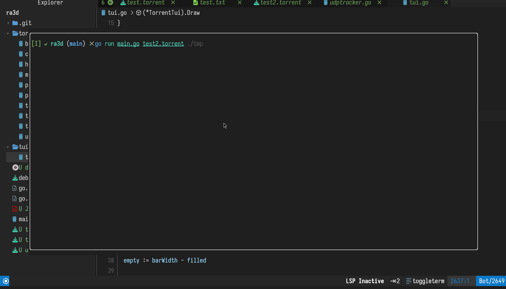

# Ra3d


Ra3d is a small BitTorrent client written in Go. Give it a `.torrent` file or a magnet link and it downloads the files while showing progress in the terminal. It downloads only, so it never seeds, and it finds peers through trackers alone because it has no DHT.

The protocol code lives in `torrent/` and is a few hundred lines. The only dependencies are a bencode library and the Charm libraries for the terminal UI.

## Install

You need Go 1.24 or newer.

```sh
git clone https://github.com/mohamedelhefni/ra3d
cd ra3d
go build -o ra3d .
```

## Usage

```sh
./ra3d [-o dir] <file.torrent | magnet-link>
```

`-o` sets the folder to download into. It defaults to the current directory.

```sh
./ra3d debain.torrent
./ra3d -o ~/Downloads debain.torrent
./ra3d -o ~/Downloads "magnet:?xt=urn:btih:1bd088ee9166a062cf4af09cf99720fa6e1a3133&tr=http%3A%2F%2Fbttracker.debian.org%3A6969%2Fannounce"
```

Quote magnet links. Without quotes, the shell cuts the link off at the first `&`.

Press `q`, `Esc` or `Ctrl+C` to quit. When the download finishes, ra3d exits on its own and leaves the last screen in your terminal.

## The screen

The top of the screen has the torrent name and a progress bar. Below that are the downloaded and total size, the download speed, an estimate of the time left, and the number of connected peers out of all the peers the trackers returned.

Under the numbers is a piece map. Each cell stands for a group of pieces and fills in as more of them finish. The bottom line says what the client is doing, for example finding peers, checking existing data or downloading.

If something fails, such as a broken torrent file or no reachable peers, the error appears in red at the bottom and ra3d exits with status 1.

## Resuming

Each piece is written to disk as soon as it passes its hash check, so stopping halfway loses only the pieces that were still downloading. To resume, run the same command with the same `-o` folder. Ra3d hash-checks the data already on disk and asks peers only for the pieces that are missing or corrupt. It keeps no separate state file because the hash check on startup tells it which pieces are done.

## Magnet links

A magnet link carries the info hash, an optional name and a list of trackers. Ra3d asks those trackers for peers, connects to them and downloads the torrent's metadata (file names, sizes and piece hashes) using the extension protocol from BEP 9 and BEP 10. It checks the metadata against the info hash before downloading anything.

Magnet links with no `tr=` trackers don't work, because finding peers for them needs DHT. Ra3d reports this as an error.

## How it works

1. Parse the `.torrent` file, or parse the magnet link and fetch the metadata from peers.
2. Create the output files at full size. A torrent with several files becomes a folder named after the torrent.
3. Hash-check any data already on disk and queue the missing pieces.
4. Ask every tracker in `announce` and `announce-list` for peers, over HTTP or UDP. This repeats every minute so peers that drop can be replaced.
5. Start one worker per peer. A worker completes the handshake, waits to learn which pieces the peer has, then takes pieces from a shared queue. It requests each piece in 16 KiB blocks, with up to 5 requests in flight, and checks the piece's SHA-1 when it arrives.
6. Write good pieces to disk. A piece that fails its hash check, or whose peer disconnects, goes back on the queue for another worker.

## Project layout

```
main.go                  flags and startup
tui/tui.go               terminal UI (bubbletea, lipgloss, bubbles)
torrent/torrentfile.go   .torrent and magnet parsing, path validation
torrent/metadata.go      fetching metadata for magnet links (BEP 9/10)
torrent/tracker.go       HTTP trackers and announcing to all trackers
torrent/udptracker.go    UDP trackers (BEP 15)
torrent/peers.go         tracker response and peer list parsing
torrent/client.go        peer connection, handshake and state
torrent/handshake.go     handshake encoding
torrent/message.go       peer wire messages
torrent/bitfield.go      which pieces a peer has
torrent/storage.go       mapping pieces onto files on disk
torrent/p2p.go           the download loop, workers and progress stats
```

## Tests

```sh
go test ./...
```

The tests check how multi-file torrents are laid out on disk, including reads and writes that cross from one file into the next. They also check resuming from existing data, rejection of unsafe paths, magnet parsing with hex and base32 hashes, and decoding of metadata messages. The networking code has no automated tests; to check it, download `debain.torrent` by hand.

## Limitations

* Download only. Ra3d never uploads to other peers.
* Peers come only from trackers. There is no DHT, PEX or local peer discovery.
* Only IPv4 peers are supported.
* There is no endgame mode, so the last few pieces can be slow when a slow peer holds them.
* A torrent whose file paths would escape the download folder, for example with `..`, is refused.

## Todo

- [ ] DHT, for magnet links without trackers
- [ ] Seeding and uploading to other peers
- [ ] Endgame mode for the last pieces
- [ ] IPv6 peers
